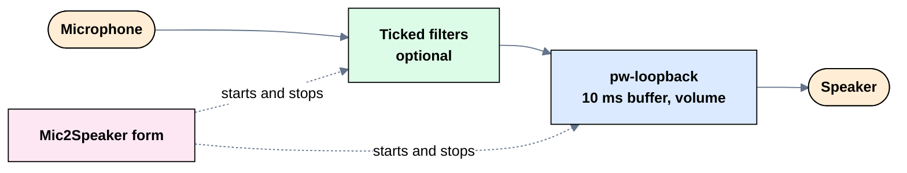

# Mic2Speaker

Mic2Speaker is a small desktop app that plays a microphone through a speaker on the same computer. Pick the input and the output, switch the toggle ON, and your voice comes out of the speaker with about 10 ms of buffering. Switch it OFF to stop. A volume slider and three optional filters help keep the speaker from howling when it can hear the microphone.


It runs on Linux desktops that use PipeWire, such as Ubuntu 24.04. Windows is not supported yet; [docs/WINDOWS.md](docs/WINDOWS.md) explains how to add it.

## Up and running

These steps take a Linux machine from nothing to hearing your own voice. They were written on Ubuntu 24.04; other distributions need the same tools under their own package names.

1. Install the system tools:

   ```bash
   sudo apt install pipewire-bin libpipewire-0.3-modules libspa-0.2-modules \
       pulseaudio-utils util-linux swh-plugins python3 python3-venv
   ```

   | Tool | Package | Used for |
   |---|---|---|
   | `pw-loopback`, `pipewire` | `pipewire-bin` | copy the sound from the microphone to the speaker, and run the filters |
   | PipeWire's echo canceller and filter chain | `libpipewire-0.3-modules`, `libspa-0.2-modules` | the Filters menu |
   | LADSPA gate and Bode frequency shifter | `swh-plugins` | Filters > Noise gate and Frequency shifter |
   | `pactl` | `pulseaudio-utils` | lists the microphones and speakers |
   | `setpriv` | `util-linux` | stops the sound if the app crashes (recommended) |
   | Python 3.10 or newer, with `venv` | `python3`, `python3-venv` | runs the app |

   The filter packages are optional. Without them the app still plays sound, and the Filters menu greys out what this computer cannot run.

2. Check that your desktop uses PipeWire:

   ```bash
   pactl info | grep "Server Name"
   ```

   The answer should mention PipeWire, for example `Server Name: PulseAudio (on PipeWire 1.0.5)`.

3. Open a terminal in the project folder and start the app:

   ```bash
   ./run.sh
   ```

   The first run creates a virtual environment in `.venv` and installs PyQt5 into it, so it needs an internet connection once. Later runs start straight away. If the shell answers "Permission denied", run `chmod +x run.sh` once.

4. Put on headphones or turn the volume down. Pick your microphone under Input and your speaker under Output, then click the big OFF button: it turns green and reads ON. Speak, and you should hear yourself. The status bar shows "Playing ... through ...".

5. Optional: run the tests as described in [Tests](#tests).

## Using it

- Both lists mark the system default device with "(default)" and select it when the app starts.
- Click the toggle to switch the sound ON or OFF. Closing the window also stops the sound.
- The Volume slider sets how loud the speaker plays the microphone, from 0 to 150 %. Drag it, or type an exact number in the box next to it and press Enter. The new volume takes effect at once.
- The Filters menu switches the echo canceller, the frequency shifter, and the noise gate on and off. While the sound is on, a change takes effect at once, and the status bar lists the active filters.
- A filter that this computer cannot run is greyed out and marked "(not available)". Hover over it to see what is missing, for example the swh-plugins package.
- While the sound is on, picking another device in either list moves the sound to it right away.
- The lists update by themselves when a device is plugged in or out, or when the system default device changes. Devices > Redetect inputs and outputs (F5) reads them again by hand and says how many devices it found.
- If a device in use is unplugged, the sound stops and is never moved to another speaker. The toggle goes back to OFF and the status bar says why.
- If the app crashes or is killed, the sound stops with it.

### Reducing echo and feedback

A microphone that hears its own speaker sends the sound around in a loop, which you hear as an echo or as a loud howl (feedback). Headphones, or more distance between the microphone and the speaker, stop the loop completely. The app can only make it weaker:

| Measure | What it does | Cost |
|---|---|---|
| Volume slider | a lower volume makes the loop weaker; below a certain level the howl stops | quieter sound |
| Noise gate | mutes the microphone while nobody speaks, so the loop cannot build up in pauses | no help while you talk; very soft speech may be cut off |
| Frequency shifter | shifts the sound up 5 Hz, so that a howl cannot settle on one room resonance; this usually allows a few dB more volume | barely audible on speech |
| Echo canceller (WebRTC) | removes the speaker's sound from the microphone signal, with noise suppression | experimental: in this loop the "echo" is your own voice, so it may also weaken or chop your voice |

A good order to try: lower the volume until the howl stops, tick the noise gate and the frequency shifter, then raise the volume again slowly.

### Other tips

- Filter and volume choices are not saved. The app always starts with no filters and the volume at 100 %.
- If the sound crackles, raise `LATENCY_MS` in [mic2speaker/audio/linux_audio_loopback.py](mic2speaker/audio/linux_audio_loopback.py) from 10 to 20. Lower values give less delay.
- The PyQt5 from pip brings its own copy of Qt, so the window uses Qt's Fusion style rather than your desktop theme.

## How it works



The form starts PipeWire's `pw-loopback`, which copies the sound from the microphone to the speaker. The ticked filters run in their own PipeWire process in between. All audio code sits behind three adapter interfaces, with one set of adapters per operating system. [docs/ARCHITECTURE.md](docs/ARCHITECTURE.md) has the component, class, sequence, and activity diagrams.

## Project layout

```
.
├── run.sh                    launcher: creates .venv on the first run, then starts the app
├── requirements.txt          runtime dependencies (PyQt5)
├── requirements-dev.txt      adds pytest
├── pytest.ini
├── mic2speaker/
│   ├── __main__.py           entry point for "python -m mic2speaker"
│   ├── app.py                picks the audio adapters for this OS and opens the window
│   ├── audio/
│   │   ├── audio_device.py                  AudioDevice: one microphone or speaker
│   │   ├── audio_filters.py                 AudioFilters: which filters are switched on
│   │   ├── audio_device_provider.py         AudioDeviceProvider interface
│   │   ├── audio_device_watcher.py          AudioDeviceWatcher interface
│   │   ├── audio_loopback.py                AudioLoopback interface
│   │   ├── linux_audio_device_provider.py   Linux adapter, lists devices with pactl
│   │   ├── linux_audio_device_watcher.py    Linux adapter, watches pactl subscribe
│   │   ├── linux_audio_loopback.py          Linux adapter, runs pw-loopback and sets the volume
│   │   ├── linux_filter_config.py           builds the PipeWire config for the filters
│   │   ├── linux_filter_process.py          runs the filters in a "pipewire -c" process
│   │   ├── linux_filter_support.py          checks which filters this computer can run
│   │   ├── linux_child_process.py           makes helper programs end with the app
│   │   ├── linux_node_names.py              names of the PipeWire nodes the app creates
│   │   └── linux_pactl.py                   runs pactl for the Linux adapters
│   └── ui/
│       ├── main_window.py        the form: menus, dropdowns, volume, toggle, status bar
│       ├── device_combo_box.py   dropdown of AudioDevice items
│       ├── volume_slider.py      volume slider with a box for typing an exact value
│       └── toggle_button.py      the big ON/OFF button
├── tests/
└── docs/
```

## Tests

```bash
.venv/bin/python -m pip install --requirement requirements-dev.txt
.venv/bin/python -m pytest
```

| Test file | What it checks | Needs audio? |
|---|---|---|
| `tests/test_main_window.py` | the form, driven through `SimulatedUser` with fake adapters | no |
| `tests/test_linux_audio_device_provider.py` | how pactl's output is read, with pactl's answers faked | no |
| `tests/test_linux_audio_device_watcher.py` | which `pactl subscribe` lines count as device changes | no |
| `tests/test_audio_filters.py` | which switched-on filters cannot run | no |
| `tests/test_linux_filter_support.py` | which filters a pretend computer can run, judged by the files it has | no |
| `tests/test_linux_filter_config.py` | the PipeWire config built for each combination of filters | no |
| `tests/test_linux_audio_integration.py` | the Linux adapters and filters against the real PipeWire server, including test tones through the noise gate and the frequency shifter | PipeWire, but no sound |

The integration tests create temporary virtual devices (silent microphones, a microphone that plays test tones, and speakers that play into nothing), so nothing reaches your real speakers, and they remove them afterwards. They carry the `integration` marker: skip them with `-m "not integration"`. They skip themselves when `pactl` or `pw-loopback` is missing. A test of a filter this computer cannot run is skipped with the reason. All of them are skipped while another Mic2Speaker plays sound, because its streams have the same names.

## Documentation

| Document | Contents |
|---|---|
| [docs/ARCHITECTURE.md](docs/ARCHITECTURE.md) | how the parts fit together, with component, class, sequence, and activity diagrams |
| [docs/WINDOWS.md](docs/WINDOWS.md) | how to add Windows support |

## Code style

- Object-oriented design, with operating-system code behind adapter classes.
- Readable code is preferred over clever code.
- Avoid nested calls such as `f(g(x))` unless they are needed; give the inner result a name first.
- Every module, class, and method has a docstring.
- Names of modules, classes, methods, variables, and constants say what the thing is or does.
