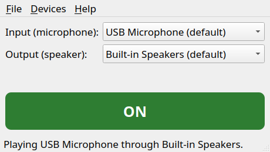

# Mic2Speaker

Mic2Speaker is a small desktop app that plays a microphone through a speaker on the same computer. Pick the input and the output, switch the toggle ON, and your voice comes out of the speaker with about 10 ms of buffering. Switch it OFF to stop.



It runs on Linux desktops that use PipeWire, such as Ubuntu 24.04. Windows is not supported yet; [docs/WINDOWS.md](docs/WINDOWS.md) explains how to add it.

## Up and running

These steps take a Linux machine from nothing to hearing your own voice. They were written on Ubuntu 24.04; other distributions need the same tools under their own package names.

1. Install the system tools:

   ```bash
   sudo apt install pipewire-bin pulseaudio-utils util-linux python3 python3-venv
   ```

   | Tool | Package | Used for |
   |---|---|---|
   | `pw-loopback` | `pipewire-bin` | copies the sound from the microphone to the speaker |
   | `pactl` | `pulseaudio-utils` | lists the microphones and speakers |
   | `setpriv` | `util-linux` | stops the sound if the app crashes (recommended) |
   | Python 3.10 or newer, with `venv` | `python3`, `python3-venv` | runs the app |

2. Check that your desktop uses PipeWire:

   ```bash
   pactl info | grep "Server Name"
   ```

   The answer should mention PipeWire, for example `Server Name: PulseAudio (on PipeWire 1.0.5)`.

3. Open a terminal in the project folder and start the app:

   ```bash
   ./run.sh
   ```

   The first run creates a virtual environment in `.venv` and installs PyQt5 into it, so it needs an internet connection once. Later runs start straight away. If the shell answers "Permission denied", run `chmod +x run.sh` once.

4. Put on headphones or turn the volume down. Pick your microphone under Input and your speaker under Output, then click the big OFF button: it turns green and reads ON. Speak, and you should hear yourself. The status bar shows "Playing ... through ...".

5. Optional: run the tests as described in [Tests](#tests).

## Using it

- Both lists mark the system default device with "(default)" and select it when the app starts.
- Click the toggle to switch the sound ON or OFF. Closing the window also stops the sound.
- While the sound is on, picking another device in either list moves the sound to it right away.
- The lists update by themselves when a device is plugged in or out, or when the system default device changes. Devices > Redetect inputs and outputs (F5) reads them again by hand and says how many devices it found.
- If a device in use is unplugged, the sound stops and is never moved to another speaker. The toggle goes back to OFF and the status bar says why.
- If the app crashes or is killed, the sound stops with it.

### Tips

- Keep the microphone away from the speaker, or use headphones. A microphone that hears its own speaker makes a loud whistle (feedback).
- If the sound crackles, raise `LATENCY_MS` in [mic2speaker/audio/linux_audio_loopback.py](mic2speaker/audio/linux_audio_loopback.py) from 10 to 20. Lower values give less delay.
- The PyQt5 from pip brings its own copy of Qt, so the window uses Qt's Fusion style rather than your desktop theme.

## Project layout

```
.
├── run.sh                    launcher: creates .venv on the first run, then starts the app
├── requirements.txt          runtime dependencies (PyQt5)
├── requirements-dev.txt      adds pytest
├── pytest.ini
├── mic2speaker/
│   ├── __main__.py           entry point for "python -m mic2speaker"
│   ├── app.py                picks the audio adapters for this OS and opens the window
│   ├── audio/
│   │   ├── audio_device.py                  AudioDevice: one microphone or speaker
│   │   ├── audio_device_provider.py         AudioDeviceProvider interface
│   │   ├── audio_device_watcher.py          AudioDeviceWatcher interface
│   │   ├── audio_loopback.py                AudioLoopback interface
│   │   ├── linux_audio_device_provider.py   Linux adapter, lists devices with pactl
│   │   ├── linux_audio_device_watcher.py    Linux adapter, watches pactl subscribe
│   │   ├── linux_audio_loopback.py          Linux adapter, runs pw-loopback
│   │   └── linux_child_process.py           makes helper programs end with the app
│   └── ui/
│       ├── main_window.py        the form: menus, dropdowns, toggle, status bar
│       ├── device_combo_box.py   dropdown of AudioDevice items
│       └── toggle_button.py      the big ON/OFF button
├── tests/
└── docs/
```

## Tests

```bash
.venv/bin/python -m pip install --requirement requirements-dev.txt
.venv/bin/python -m pytest
```

| Test file | What it checks | Needs audio? |
|---|---|---|
| `tests/test_main_window.py` | the form, driven through `SimulatedUser` with fake adapters | no |
| `tests/test_linux_audio_device_provider.py` | how pactl's output is read, with pactl's answers faked | no |
| `tests/test_linux_audio_device_watcher.py` | which `pactl subscribe` lines count as device changes | no |
| `tests/test_linux_audio_integration.py` | the three Linux adapters against the real PipeWire server | PipeWire, but no sound |

The integration tests create temporary virtual devices (a silent microphone and two speakers that play into nothing), so nothing reaches your real speakers, and they remove them afterwards. They carry the `integration` marker: skip them with `-m "not integration"`. They skip themselves when `pactl` or `pw-loopback` is missing.

## Documentation

| Document | Contents |
|---|---|
| [docs/ARCHITECTURE.md](docs/ARCHITECTURE.md) | how the classes fit together and what happens when you click ON |
| [docs/WINDOWS.md](docs/WINDOWS.md) | how to add Windows support |

## Code style

- Object-oriented design, with operating-system code behind adapter classes.
- Readable code is preferred over clever code.
- Avoid nested calls such as `f(g(x))` unless they are needed; give the inner result a name first.
- Every module, class, and method has a docstring.
- Names of modules, classes, methods, variables, and constants say what the thing is or does.
