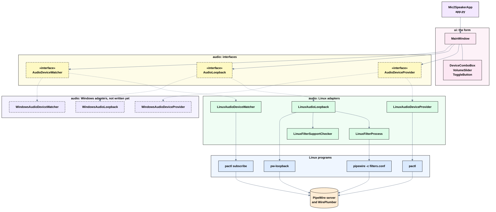
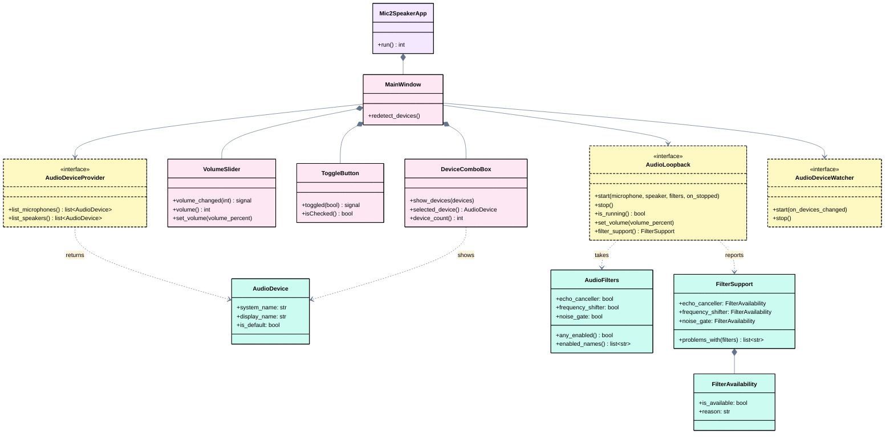
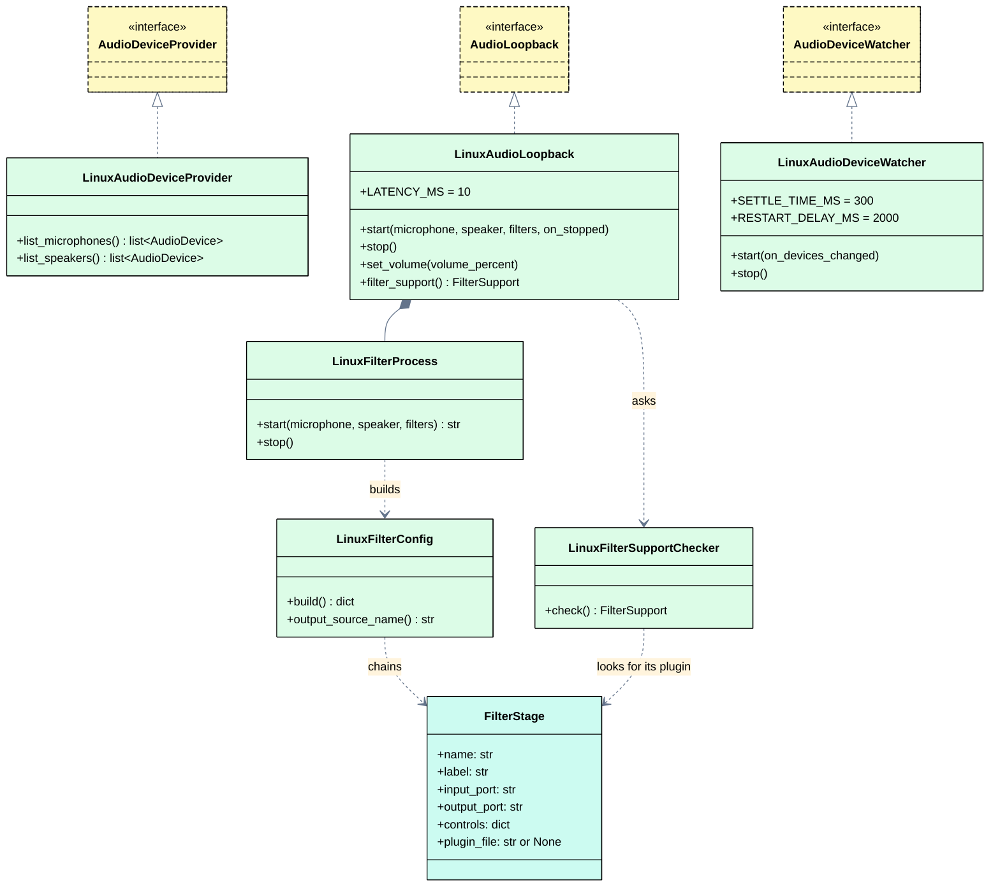
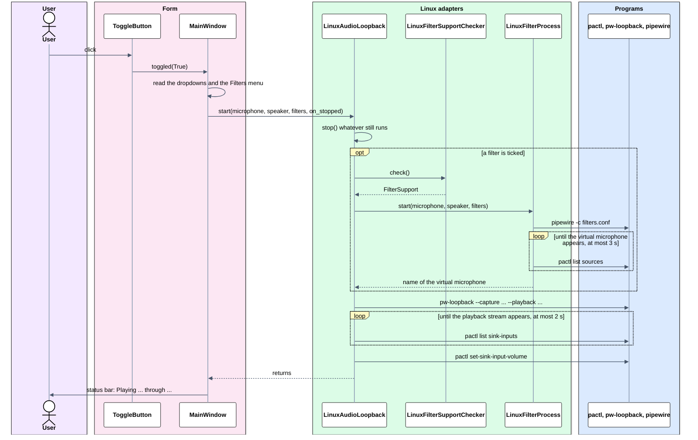
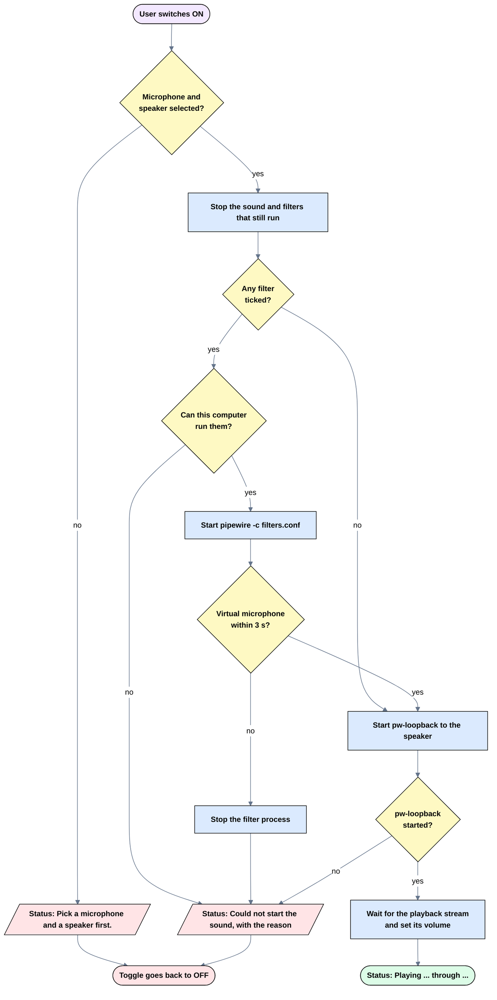
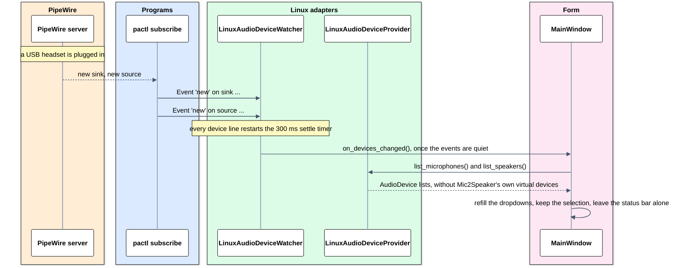
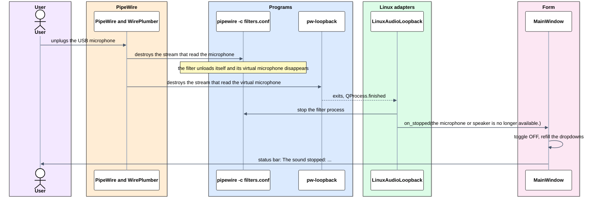
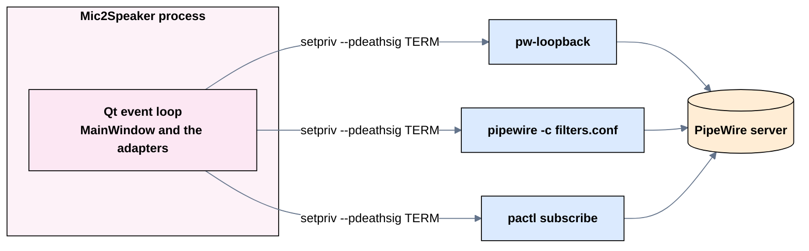

# Architecture

The form in `mic2speaker/ui` talks to the operating system only through three interfaces in `mic2speaker/audio`. Each operating system implements those interfaces in its own adapter classes, and `mic2speaker/app.py` picks the adapters for the system it runs on and hands them to the form.

The diagrams on this page are written in [Mermaid](https://mermaid.js.org/). GitHub shows them as pictures; in VS Code, the "Markdown Preview Mermaid Support" extension does the same in the Markdown preview. A colour means the same thing in every diagram:

| Colour | Part |
|---|---|
| pink | the form and its widgets |
| yellow, dashed border | interfaces |
| green | Linux adapters and their helpers |
| lavender, dashed border | Windows adapters, not written yet |
| blue | programs the adapters start |
| orange | PipeWire and the audio devices |
| purple | the app object and the user |
| mint | small data classes |

## Components



Solid arrows point to what a part uses or starts. Dotted arrows point from an interface to the classes that implement it. Two arrows are left out to keep the picture readable: `Mic2SpeakerApp` also creates the adapters for the operating system it runs on and hands them to `MainWindow`, and `LinuxAudioLoopback` also runs `pactl` to set the volume.

The form never imports an adapter. Supporting another operating system therefore means writing three adapter classes and choosing them in `app.py`; the form and its tests stay as they are. [WINDOWS.md](WINDOWS.md) walks through this for Windows.

## Classes

The form and the interfaces it depends on:



The Linux adapters and the classes they use:



The helper modules `linux_pactl` and `linux_child_process`, which most of these classes use, are left out of the diagram; the paragraph below the table describes them.

| Class | Module | Job |
|---|---|---|
| `Mic2SpeakerApp` | `app.py` | creates the Qt application, picks the adapters, shows the window |
| `MainWindow` | `ui/main_window.py` | the form; reacts to the toggle, the dropdowns, the slider, the menus, and device changes |
| `DeviceComboBox` | `ui/device_combo_box.py` | dropdown of `AudioDevice` items; keeps the user's choice when the list is refilled |
| `VolumeSlider` | `ui/volume_slider.py` | slider from 0 to 150 % with a number box for typing an exact value |
| `ToggleButton` | `ui/toggle_button.py` | the ON/OFF button; its text and colour follow its state |
| `AudioDevice` | `audio/audio_device.py` | one microphone or speaker: `system_name`, `display_name`, `is_default` |
| `AudioFilters` | `audio/audio_filters.py` | which of the echo canceller, frequency shifter, and noise gate are on |
| `FilterSupport`, `FilterAvailability` | `audio/audio_filters.py` | which filters this computer can run, and why the others cannot |
| `AudioDeviceProvider` | `audio/audio_device_provider.py` | interface with `list_microphones()` and `list_speakers()` |
| `AudioLoopback` | `audio/audio_loopback.py` | interface with `start(microphone, speaker, filters, on_stopped)`, `stop()`, `is_running()`, `set_volume()`, and `filter_support()` |
| `AudioDeviceWatcher` | `audio/audio_device_watcher.py` | interface with `start(on_devices_changed)` and `stop()` |
| `LinuxAudioDeviceProvider` | `audio/linux_audio_device_provider.py` | Linux adapter; reads the devices with `pactl --format=json` |
| `LinuxAudioLoopback` | `audio/linux_audio_loopback.py` | Linux adapter; runs `pw-loopback` and sets the volume of its stream |
| `LinuxFilterProcess` | `audio/linux_filter_process.py` | runs the filters in a `pipewire -c <config>` helper process |
| `LinuxFilterConfig` | `audio/linux_filter_config.py` | builds that config for one set of filters |
| `LinuxFilterSupportChecker` | `audio/linux_filter_support.py` | finds out which filters this Linux computer can run, by looking for files |
| `LinuxAudioDeviceWatcher` | `audio/linux_audio_device_watcher.py` | Linux adapter; reads the events that `pactl subscribe` prints |

Three small helper modules support the Linux classes. `linux_pactl.py` runs `pactl` and turns its failures into one exception type, `linux_node_names.py` holds the names of the PipeWire nodes the app creates, and `linux_child_process.py` holds `command_that_ends_with_app()` (see [When the app closes or crashes](#when-the-app-closes-or-crashes)).

`AudioDevice.system_name` is the name the audio system uses (on Linux, for example, `alsa_input.usb-...mono-fallback`). It stays the same between runs, which lets `DeviceComboBox` keep the user's choice when the lists are refilled. `display_name` is what the user sees.

## What happens when you click ON



1. `ToggleButton` emits `toggled(True)`, and `MainWindow._handle_toggle` calls `_start_sound`.
2. `_start_sound` reads the selected `AudioDevice` from each dropdown and the ticked items of the Filters menu, and calls `audio_loopback.start(microphone, speaker, filters, on_stopped=self._handle_sound_stopped)`.
3. On Linux, `LinuxAudioLoopback.start` stops anything still running. If a filter is ticked, it first starts the filters (see [Filters](#filters)) and reads their virtual microphone instead of the real one. Then it starts `pw-loopback`:

   ```
   setpriv --pdeathsig TERM -- pw-loopback --name mic2speaker --latency 10 \
       --capture <microphone, or the filters' virtual microphone> \
       --capture-props "node.dont-reconnect=true media.name=Mic2Speaker" \
       --playback <speaker system_name> \
       --playback-props "node.dont-reconnect=true media.name=Mic2Speaker"
   ```

4. It waits for the playback stream to appear and sets its volume with `pactl set-sink-input-volume`.
5. The status bar shows "Playing <microphone> through <speaker>.", followed by the active filters if there are any.

Every way the start can end, including the errors the user sees:



Picking another device or ticking a filter while the toggle is ON repeats this from the start. Moving the volume slider calls `audio_loopback.set_volume()`, which changes the stream's volume at once. Clicking OFF calls `audio_loopback.stop()`, which ends `pw-loopback` and the filters.

WirePlumber remembers the last volume of each stream and sets it again when the stream appears. Because the app sets the slider's value right after the stream appears, the slider's value is what you hear.

## Filters

```mermaid
%%{init: {"theme": "base", "themeVariables": {"lineColor": "#64748b", "primaryTextColor": "#000000", "primaryBorderColor": "#000000", "textColor": "#000000", "titleColor": "#000000", "edgeLabelBackground": "#ffffff", "fontSize": "14px"}}}%%
flowchart LR
    microphone(["<b>Microphone</b>"])

    subgraph helper ["<b>pipewire -c filters.conf</b>"]
        echo_canceller["<b>Echo canceller<br/>WebRTC, monitor mode</b>"]
        noise_gate["<b>Noise gate<br/>gate_1410.so</b>"]
        frequency_shifter["<b>Frequency shifter<br/>bode_shifter_1431.so<br/>+5 Hz</b>"]
        makeup_gain["<b>Makeup gain<br/>built-in linear, ×2</b>"]
        virtual_microphone(["<b>Virtual microphone</b>"])
    end

    pw_loopback["<b>pw-loopback<br/>10 ms buffer, volume</b>"]
    speaker(["<b>Speaker</b>"])

    microphone --> echo_canceller --> noise_gate --> frequency_shifter --> makeup_gain --> virtual_microphone
    virtual_microphone --> pw_loopback --> speaker
    speaker -.->|"monitor: what the speaker plays"| echo_canceller

    classDef device_part fill:#ffedd5,stroke:#000000,color:#000000
    classDef filter_part fill:#dcfce7,stroke:#000000,color:#000000
    classDef virtual_part fill:#ccfbf1,stroke:#000000,color:#000000
    classDef program_part fill:#dbeafe,stroke:#000000,color:#000000

    class microphone,speaker device_part
    class echo_canceller,noise_gate,frequency_shifter,makeup_gain filter_part
    class virtual_microphone virtual_part
    class pw_loopback program_part

    style helper fill:#eff6ff,stroke:#000000,color:#000000
```

The filters run in a helper process started with `pipewire -c <config file>`. `LinuxFilterConfig` builds the config as Python dictionaries and `LinuxFilterProcess` saves it as JSON, which PipeWire's SPA-JSON format accepts, in a temporary directory. With every filter ticked, the sound takes this path; a filter that is not ticked is simply left out of the chain:



- The echo canceller is PipeWire's `libpipewire-module-echo-cancel` with the WebRTC library, noise suppression, and the high-pass filter, without automatic gain (which would raise the feedback). It runs in monitor mode: it takes the sound to remove from the speaker's monitor. The other mode, in which pw-loopback would play into a sink that belongs to the echo canceller, makes a loop between the canceller's own nodes, and WirePlumber refuses to link such loops.
- The noise gate (`gate_1410.so` from swh-plugins) and the frequency shifter (`bode_shifter_1431.so`, shifted up 5 Hz) run in `libpipewire-module-filter-chain`. The shifter's output is 6 dB quieter than its input, so PipeWire's built-in `linear` plugin doubles it again.
- The last filter offers its output as a virtual microphone (`mic2speaker_echo_cancel_source` or `mic2speaker_filtered_microphone`), which pw-loopback reads.

`LinuxFilterProcess.start` waits until that virtual microphone appears before pw-loopback starts, because pw-loopback would otherwise give up on its missing target. The virtual devices all start with `mic2speaker`, and `LinuxAudioDeviceProvider` leaves them out of the dropdowns.

### Which filters can run

Other computers may lack some of these parts. `LinuxAudioLoopback.filter_support()` asks `LinuxFilterSupportChecker`, which only looks for files and starts nothing:

| Filter | Needs |
|---|---|
| all three | the `pipewire` program |
| echo canceller | the echo-cancel module with the text `monitor.mode` inside it (older PipeWire versions lack monitor mode), and the WebRTC plugin |
| noise gate | the filter-chain module and `gate_1410.so` |
| frequency shifter | the filter-chain module and `bode_shifter_1431.so` |

The result is a `FilterSupport` with one `FilterAvailability` per filter. `MainWindow` greys out the filters that cannot run, adds "(not available)" to their names, and puts the reason, such as the package to install, in their tooltips. `start()` checks again and refuses an unavailable filter with the same reason, so the sound never depends on the menu's state alone. A filter that passes the file check can still fail to start; the user then sees PipeWire's error in the status bar.

## When a device is plugged in or out



`LinuxAudioDeviceWatcher` keeps `pactl subscribe` running. That command prints a line for every change on the audio server, such as `Event 'new' on sink #57`. The watcher reacts to new or removed sinks (speakers) and sources (microphones), and to `change` events on the server, which is how a new system default device shows up. It ignores `change` events on sinks and sources, because those fire on every volume change and whenever a device starts playing, including for Mic2Speaker's own sound. It runs `pactl` with `LC_ALL=C` because pactl translates the line format.

Plugging in a USB headset produces several events in quick succession, so the watcher waits until the events have been quiet for 300 ms and then calls `MainWindow._handle_devices_changed` once. That method refills both dropdowns and leaves the status bar alone. Devices that are still connected stay selected, so sound that is playing goes on. If `pactl subscribe` exits, for example because PipeWire restarted, the watcher starts it again after two seconds and reports one change so that the lists are read again.

Devices > Redetect inputs and outputs (F5) calls `MainWindow.redetect_devices`, which refills the dropdowns the same way and also shows how many devices it found.

## When a device in use is unplugged



Every stream carries `node.dont-reconnect=true`: pw-loopback's two streams and, when filters run, the streams of the echo canceller and the filter chain. Without it, WirePlumber (PipeWire's session manager) would move the sound to another device, for example from unplugged USB speakers to the laptop speakers next to the microphone. With it, WirePlumber destroys the stream instead. A filter whose stream is destroyed unloads itself, its virtual microphone disappears, and that in turn ends pw-loopback's capture stream. Without filters, the unplugged device ends one of pw-loopback's streams directly. Either way, `pw-loopback` exits.

`LinuxAudioLoopback` notices the exit through `QProcess.finished`, ends the filter process (which keeps running even with nothing left in it), and calls the `on_stopped` callback. `MainWindow._handle_sound_stopped` then turns the toggle OFF, refills the device lists, and shows the reason in the status bar. When the app itself calls `stop()`, the adapter disconnects from `finished` first, so a requested stop is never reported as an unexpected one.

## When the app closes or crashes



`MainWindow.closeEvent` stops the device watcher and the sound before the window closes. For crashes, `pw-loopback`, `pipewire -c`, and `pactl subscribe` are all started through `command_that_ends_with_app()`, which puts `setpriv --pdeathsig TERM` in front of the command. setpriv asks the Linux kernel to send the program SIGTERM when its parent (the app) dies, so the microphone cannot keep playing without a window to switch it off. If `setpriv` is not installed, the programs are started directly and this protection is lost.

## Tests

`tests/fakes.py` has `FakeDeviceProvider`, `FakeAudioLoopback`, and `FakeDeviceWatcher`, which implement the three interfaces without making sound. `tests/simulated_user.py` has `SimulatedUser`, which clicks, picks, drags the slider, types a volume, and ticks menu items on the form the way a person would, finding the widgets with `findChild()` and their object names. With these, `tests/test_main_window.py` checks the form's behaviour on any operating system. `tests/test_linux_filter_config.py` checks the filter config for each combination of filters, with empty files standing in for the LADSPA plugins. `tests/test_linux_filter_support.py` builds pretend computers in a temporary directory, each missing a different file, and checks what the support check reports.

`tests/test_linux_audio_integration.py` checks the Linux adapters against the real PipeWire server, using temporary virtual devices made with `pactl load-module module-null-sink`. It checks how every filter is linked, that unplugging the microphone or the speaker ends everything, and that the watcher notices devices and ignores the app's own sound. For the filters' effect it plays test tones into a virtual microphone and measures what reaches a virtual speaker: the noise gate must block a -70 dBFS tone and pass a -20 dBFS one, and the frequency shifter must keep the level within 2 dB. Every filter that `filter_support()` reports as available must also start. Tests of filters this computer cannot run are skipped with the reason, and all integration tests are skipped while another Mic2Speaker plays sound, because its streams and devices have the same names.
